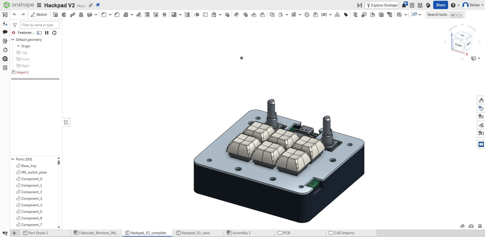

# hackpad_v2

A wireless six-key macropad with a Seeed XIAO ESP32-S3, two clickable rotary encoders, and twelve SK6812 MINI-E RGB LEDs. The simple build powers RGB only from USB and uses a protected 500mAh battery for the controller. The PCB retains all original expander and battery RGB footprints for later upgrades. It uses normal 19.05 mm key spacing and an internal battery connector, uses parts left over from my other hackpad, which was much worse.

## Files

| Folder | Contents |
| --- | --- |
| [case](case/) | Separate base and cover STEP files, plus a combined case STEP |
| [pcb](pcb/) |  KiCad project |
| [manufacturing](manufacturing/) | Gerber and drill files ZIP |

### Downloads

- [Base STEP](case/Base_tray.step)
- [Cover STEP](case/MX_switch_plate.step)
- [Combined case STEP](case/Hackpad_V2_case.step)
- [Onshape Link](https://cad.onshape.com/documents/e5e00bd96b00b1f98fd3bff8/w/d80bdedc56342f5387c6fe9a/e/5cf3044721cd9ba3212c3cf5?renderMode=0&uiState=6ad18d197901a43b19ded2cc)
- [PCB STEP](pcb/Fabricate_Wireless_Macropad.step)
- [Gerber/drill ZIP](manufacturing/Gerbers-and-drills.zip)
- [BOM](BOM.md) / [CSV](BOM.csv)
- [Build and upgrade jumper settings](pcb/Build-options.md)
- [Schematic PDF](docs/Schematic.pdf)
- [Verification and remaining hardware checks](pcb/Verification.md)
- [Printable base](case/Base_tray.stl) / [plate](case/MX_switch_plate.stl)

## Simple build and later upgrades

Leave U2 and the battery RGB converter parts unpopulated for the cheaper build. Configure the seven solder jumpers as shown in the build instructions. All 71 original footprints remain; fourteen optional parts are marked DNP. Open the USB-to-RGB bypass JP7 before adding the boost circuit later.

The current parts cart is $34.07 including estimated shipping/tariffs, before sales tax; PCB fabrication and case printing are extra. The local case exports have narrower guides for the Adafruit 1578 battery. The linked Onshape model and original project image have not been updated. The included PCB STEP remains the fully populated mechanical reference, without the new flat solder jumpers.

KiCad checks report zero DRC violations, zero unconnected items, zero schematic mismatches and zero ERC violations. Firmware is unchanged: the direct matrix needs the new pin map, and USB/BLE HID still require hardware verification.
