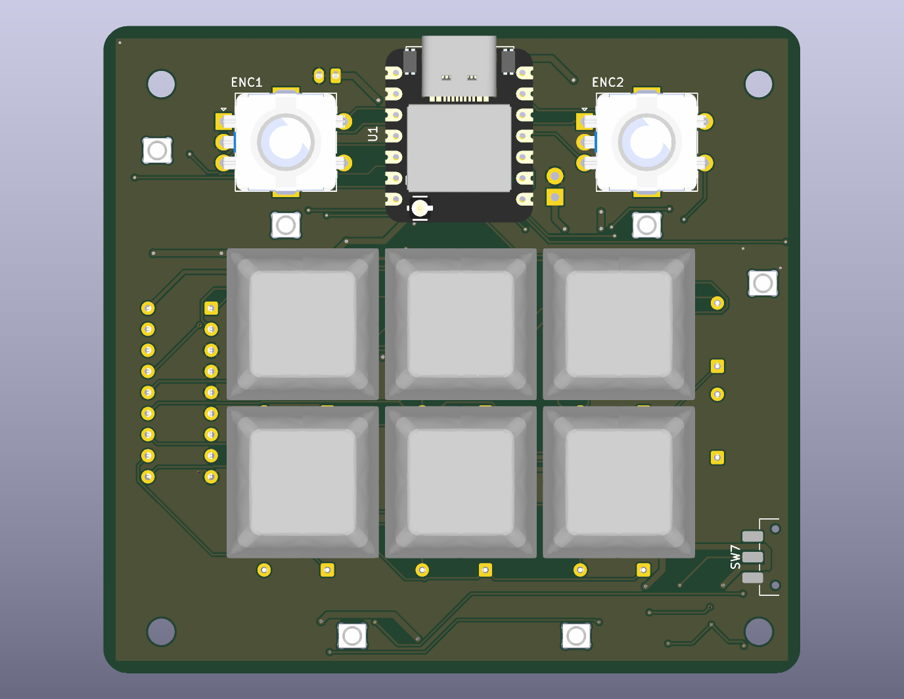
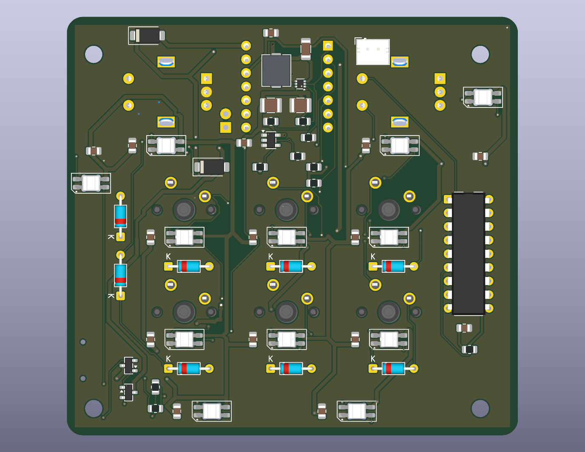

# Macropad
A custom macropad with 6 keys, bluetooth(ESP32-S3), battery, RGB, 2 and rotary encoders. This is my second macropad, because the first one wasn't that good but I still have parts some parts left over from it. 

Files:

[PCB](PCB)

[Case](https://github.com/Catsarepro21/hackpad_v2/blob/main/case)

[Gerbers](PCB/gerbers.zip)

BOM: [BOM.md](BOM.md)

